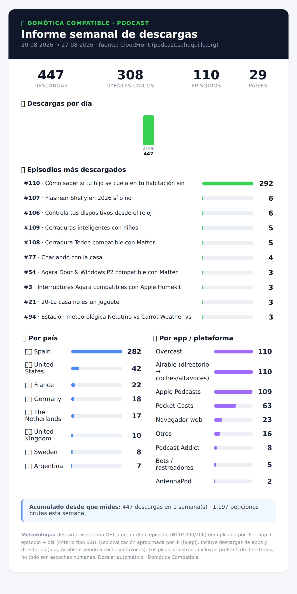

# cf-podcast-stats

**Weekly download analytics for a self-hosted podcast — delivered as a nice HTML email.**

If you host your podcast MP3s yourself (S3 behind CloudFront or Cloudflare R2) instead of using
Spotify for Podcasters / Podbean / Buzzsprout, you lose the pretty download dashboard those
platforms give you. This tool reads your **CloudFront access logs** or **Cloudflare R2 Data Access Logs**,
then emails you a weekly dossier. CloudFront logs support listener, app and country estimates;
the R2 path reports aggregate observed MP3 requests per episode without reading IP addresses or
user agents.

It's intentionally small (one Python file, standard library + the AWS CLI) and easy to self‑host.



---

## What you get, every week

- **CloudFront downloads** — IAB‑style deduplicated (per IP + app + episode + day), not raw hits.
- CloudFront mode also provides **unique listeners**, **episode/country counts**, a daily chart,
  geolocation and platform breakdowns.
- **Top episodes** (with real titles if you point it at your RSS feed).
- CloudFront mode classifies **apps / platforms** — Apple Podcasts, Spotify, Overcast, Pocket Casts, Castbox, AntennaPod,
  Amazon/Alexa, directory aggregators like Airable, web browsers, bots…
- CloudFront mode keeps an **all‑time total** accumulated across weekly runs.
- A short **methodology** note so you (or a sponsor) understand exactly what's counted.

CloudFront mode produces a deduplicated estimate; R2 mode deliberately reports only observed
requests and should not be presented as a count of unique listeners or confirmed plays.

---

## How it works

1. The selected source provides request records: CloudFront standard logs in S3, or aggregate
   counts from Cloudflare R2 Data Access Logs through the Workers Observability API.
2. Once a week a timer runs `weekly_report.py`, which:
   - reads the last *N* days of logs from the selected source,
   - keeps only `GET` requests to `*.mp3` episode files with HTTP `200`/`206`,
   - drops IPs listed in `CFPS_EXCLUDE_IPS` and bots/crawlers (reported separately in the footer),
   - deduplicates them the IAB way, classifies the user‑agent, geolocates the IP,
   - resolves episode titles from your RSS feed (optional),
   - renders an HTML dossier and emails it (Gmail API **or** any SMTP server).

No separate database or tracking pixel. If country estimates are enabled, listener IPs are sent
to ip-api.com in batches; disable that lookup with `CFPS_GEOIP=0`.

---

## Setup

### 1. Choose a log source

Set `CFPS_SOURCE=cloudfront` for the legacy S3 flow below, or `CFPS_SOURCE=r2` to query Cloudflare's
`r2` dataset in Workers Observability. Enable R2 Data Access Logs on the podcast bucket first. The
R2 source requires an account-scoped token able to run Workers Observability telemetry queries
(Cloudflare documents `Workers Observability Write` for this API endpoint) and the account ID. On EC2,
prefer storing the token as an AWS SSM `SecureString` and setting
`CFPS_CLOUDFLARE_API_TOKEN_SSM_PARAMETER`; the instance role must be allowed to read that parameter.
The script retrieves it in memory via the AWS CLI and does not print it. A direct
`CFPS_CLOUDFLARE_API_TOKEN` environment value is also supported for local runs. Never commit the token.
This scope is broader than read-only, so review and scope it carefully before adding it to an automation.

The script requests aggregate results only: public GET requests for MP3 objects with status 200 or
206, grouped by object path. It never requests event rows, IP addresses or user agents. Therefore the
R2 report cannot deduplicate listeners, classify apps/bots, or estimate countries; range requests may
count more than once. These are observed object requests, not confirmed listens or a complete record.
Keep `CFPS_WINDOW_DAYS` at seven or fewer.

R2 logs retain seven days, are delivered asynchronously and best effort, and are not backfilled.
The first report after enabling logs covers only the period since activation. Counts represent
observed requests, not confirmed listens or a complete download record. Keep `CFPS_WINDOW_DAYS`
at seven or fewer.

### 2. Enable CloudFront standard logging (legacy source)

In the CloudFront distribution that serves your podcast (e.g. `podcast.example.com`), turn on
**Standard logging** and point it at an S3 bucket + optional prefix. Wait a few hours for logs
to appear (CloudFront delivers them with some delay).

### 3. Give the machine read access to the log bucket (legacy source)

The machine that runs the report needs `s3:GetObject` + `s3:ListBucket` on the log bucket.
On EC2, attach an IAM policy to the instance role — see [`docs/iam-policy.example.json`](docs/iam-policy.example.json).
Off‑AWS, configure the AWS CLI with credentials that can read the bucket.

### 4. Install

```bash
git clone https://github.com/csahuquillo/cf-podcast-stats.git /opt/cf-podcast-stats
cd /opt/cf-podcast-stats
python3 -m venv venv
# Only needed if you send via the Gmail API (SMTP needs nothing extra):
./venv/bin/pip install -r requirements.txt
```

For the CloudFront source, the AWS CLI (`aws`) must be installed and able to read the log bucket.

### 5. Configure

```bash
cp config.example.env .env
$EDITOR .env
```

Minimum: the source's settings, `CFPS_EMAIL_TO`, and your email method. See
[`config.example.env`](config.example.env) for every option (episode‑id regex, brand, RSS feed
for titles, geoip on/off, etc.).

**Email:** pick one of
- `CFPS_EMAIL_METHOD=smtp` — works with any SMTP server (Gmail app password, Fastmail, your own…).
- `CFPS_EMAIL_METHOD=gmail_api` — use a Google OAuth token json with the `gmail.send` scope.
- `CFPS_EMAIL_METHOD=none` — write the HTML to `state/last_report.html` instead of emailing.

### 6. Test it

```bash
./venv/bin/python weekly_report.py --test
```

`--test` sends a `[TEST]` email and does **not** update the all‑time counter.

For an R2 connection check that must not send email or write a report file, use:

```bash
./venv/bin/python weekly_report.py --dry-run
```

`--dry-run` is available only for the R2 source. It queries aggregates and renders the report in memory.

### 7. Schedule it (Sunday night)

**systemd** (recommended) — copy and enable the provided units:

```bash
sudo cp systemd/cf-podcast-stats.service systemd/cf-podcast-stats.timer /etc/systemd/system/
sudo systemctl daemon-reload
sudo systemctl enable --now cf-podcast-stats.timer
systemctl list-timers cf-podcast-stats.timer
```

**cron** alternative:

```cron
0 22 * * 0  /opt/cf-podcast-stats/venv/bin/python /opt/cf-podcast-stats/weekly_report.py >> /opt/cf-podcast-stats/state/cron.log 2>&1
```

---

## Configuration reference

| Variable | Meaning |
|---|---|
| `CFPS_SOURCE` | `cloudfront` (default) or `r2` |
| `CFPS_LOG_BUCKET` | S3 bucket with the CloudFront logs (CloudFront source) |
| `CFPS_LOG_PREFIX` | key prefix inside the bucket (optional) |
| `CFPS_CLOUDFLARE_API_TOKEN` | Cloudflare Workers Observability API token (R2 source; protected secret only) |
| `CFPS_CLOUDFLARE_API_TOKEN_SSM_PARAMETER` | AWS SSM SecureString name (preferred on EC2; e.g. `/qpg/automations/cf-podcast-stats/cloudflare_api_token`) |
| `CFPS_AWS_REGION` | AWS region for reading the SecureString (default `eu-west-3`) |
| `CFPS_CLOUDFLARE_ACCOUNT_TAG` | 32-character Cloudflare account ID (R2 source) |
| `CFPS_R2_BUCKET` | R2 podcast bucket name (R2 source) |
| `CFPS_R2_DATASET` | Workers Observability dataset (default `r2`) |
| `CFPS_EPISODE_REGEX` | regex whose first group is the episode id in the URI (default `/([^/]+?)\.mp3`) |
| `CFPS_WINDOW_DAYS` | rolling window per report (default `7`) |
| `CFPS_BRAND` | podcast name shown in the email |
| `CFPS_CF_HOST` | your podcast host, shown in the header |
| `CFPS_FEED_URL` | RSS URL to resolve episode titles (optional) |
| `CFPS_GEOIP` | `1` = geolocate via ip‑api.com (free); `0` = skip |
| `CFPS_EXCLUDE_IPS` | comma‑separated IPs to ignore, e.g. your own web server if it proxies the MP3 (see below) |
| `CFPS_STATE_DIR` | cache/state/log dir (default `./state`) |
| `CFPS_EMAIL_TO` / `CFPS_EMAIL_FROM` | recipient / sender |
| `CFPS_EMAIL_METHOD` | `smtp` \| `gmail_api` \| `none` |
| `CFPS_SMTP_*` | SMTP host/port/tls/user/pass |
| `CFPS_GOOGLE_TOKEN` | path to a Gmail OAuth token (for `gmail_api`) |

---

## Methodology & limitations

- A **download** is a `GET` to an episode `.mp3` returning `200`/`206`, deduplicated by
  **IP + app + episode + day** — the common IAB‑style rule. This is stricter than "raw requests"
  (a single listen can be several `206` range requests) and looser than "confirmed human plays".
- **Geolocation** is approximate (IP → country via [ip‑api.com](https://ip-api.com), free tier,
  cached). Disable with `CFPS_GEOIP=0`.
- **Release‑day spikes** include directory/aggregator prefetch (Apple, Airable, etc.) fetching the
  new episode — that's normal and counts as a download in every platform, but it's not all humans.
- **Bots / crawlers** (GPTBot, curl, Guzzle, headless browsers…) are excluded from downloads, countries
  and apps; their count is shown in the footer.
- CloudFront logs are **delayed** (up to ~24h) and only exist from the moment you enabled logging.
- R2 Data Access Logs have seven-day retention, are asynchronous and best effort, and are not
  backfilled. This source counts observed public MP3 GET requests per object; it cannot deduplicate
  listeners or identify apps, bots, or countries without processing event-level identifiers.
- The all‑time total starts from your first run; there's no back‑fill of history you never logged.

## Gotcha: WordPress plugins that proxy the MP3 (everything looks like one country)

Some podcast plugins serve "download" links by **fetching the MP3 from CloudFront on the web server
and streaming it to the listener**. CloudFront then only sees your *server's* IP, so all those
listens geolocate to the server's country (e.g. an EC2 in Paris → "France").

- **Seriously Simple Podcasting** does this for `/podcast-download/<id>/…?ref=download` URLs, but only
  when the enclosure URL was not changed by the `ssp_enclosure_url` filter. The mu‑plugin in
  [`contrib/wordpress/ssp-descarga-directa-cloudfront.php`](contrib/wordpress/ssp-descarga-directa-cloudfront.php)
  appends `dl=1` for those requests, so SSP issues a 302 to CloudFront instead and the listener
  downloads directly (real IP and country). Drop it in `wp-content/mu-plugins/` and adjust the host.
- For history (or plugins you can't change), set `CFPS_EXCLUDE_IPS=<your server IP>` so those
  requests are not attributed to the wrong country. Their count is shown in the report footer.

To detect it: look for one IP with thousands of `.mp3` requests and an empty user‑agent (`-`).

## Why not just use `<hosting platform>`?

Because you already host on S3 + CloudFront (cheap, no lock‑in, you own the feed and the files),
and the download data is sitting in your own bucket. This turns it into the dashboard you'd
otherwise pay a platform for — in ~400 lines you fully control.

## License

MIT — see [LICENSE](LICENSE). Contributions welcome.
